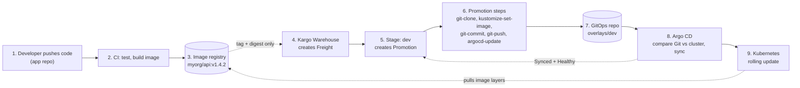
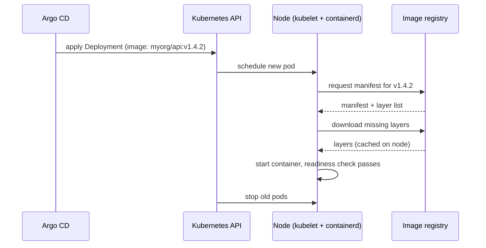
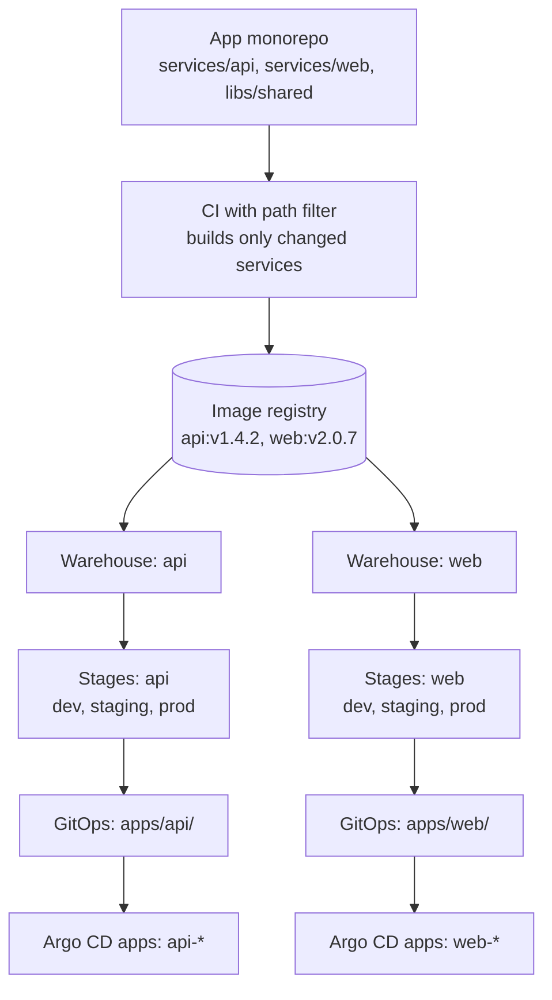

# CI/CD with Kargo, Argo CD and Kubernetes (monorepo-friendly)

> Study notes. YAML is simplified. Field names change between Kargo versions, so check the official docs before copying.

## 1. One-line summary

**Kargo changes Git. Argo CD changes the cluster.** Kargo decides which version goes to which environment and in what order, and writes that decision into a GitOps repo. Argo CD makes the cluster match the GitOps repo. Kubernetes pulls the image directly from the registry.

## 2. Components and responsibilities

| Component | Job | What it never does |
|---|---|---|
| CI (GitHub Actions, GitLab CI, Jenkins) | Test, build and push the image | Touch the GitOps repo or the cluster |
| Image registry (ECR, GHCR, Docker Hub) | Store image layers and manifests | Decide anything |
| Kargo | Track versions, enforce promotion order, edit the GitOps repo, run verification | Apply anything to the cluster itself |
| GitOps repo | Record the desired state of each environment | Run anything |
| Argo CD | Make the cluster equal to Git, report health | Choose which version goes where |
| Kubernetes | Run the pods, pull images | Know about Git |

## 3. Kargo vocabulary

- **Warehouse**: watches a registry (and optionally Helm charts or Git) for new artifacts.
- **Freight**: an immutable bundle of exact versions (for example image `myorg/api` at `v1.4.2` plus its digest). It has a unique ID. **It is only a reference, not the image data.**
- **Stage**: an environment (dev, staging, prod). It declares which Freight it accepts and which Stages the Freight must pass first.
- **Promotion**: one run of a Stage's promotion steps for one piece of Freight.
- **Verification**: tests Kargo runs after a promotion. If they pass, the Freight is marked verified in that Stage, which unlocks the next Stage.

## 4. End-to-end flow



### Step by step

1. **Push code.** A developer merges to the app repo.
2. **CI builds the image.** It runs tests, builds from the `Dockerfile`, tags the image (version or commit SHA) and pushes it. CI stops here.
3. **Registry.** Stores `myorg/api:v1.4.2` as a manifest plus layers.
4. **Warehouse.** Polls the registry using your rules (for example "semver `>= 1.0`"). On a new tag it creates a Freight.
5. **Stage: dev.** Accepts Freight straight from the Warehouse. With auto-promotion on, it creates a Promotion.
6. **Promotion steps.** Clone the GitOps repo, set the new tag in the dev overlay, commit, push, then tell Argo CD to refresh.
7. **GitOps repo.** Now says "dev runs `v1.4.2`".
8. **Argo CD.** Renders the manifests, compares them with the cluster, sees the image differs and syncs.
9. **Kubernetes.** Rolling update: new pods start, pass readiness, old pods stop.

**Feedback loop.** Kargo waits until Argo CD reports the app as Synced and Healthy. Then it runs verification. If that passes, the Freight is verified in dev and becomes available to staging. Staging repeats steps 5 to 9 with its own overlay. Prod usually waits for a human to approve.

## 5. GitOps repo layout and what changes

```
gitops-repo/
  apps/api/
    base/
      deployment.yaml
      service.yaml
      kustomization.yaml
    overlays/
      dev/kustomization.yaml        # Kargo edits this for dev
      staging/kustomization.yaml    # Kargo edits this for staging
      prod/kustomization.yaml       # Kargo edits this for prod
  argocd/
    api-dev.yaml                    # Argo CD Application for dev
    api-staging.yaml
    api-prod.yaml
```

The only change a dev promotion commits:

```diff
 images:
   - name: myorg/api
-    newTag: v1.4.1
+    newTag: v1.4.2
```

## 6. Argo CD Application (one per environment)

```yaml
apiVersion: argoproj.io/v1alpha1
kind: Application
metadata:
  name: api-dev
  annotations:
    kargo.akuity.io/authorized-stage: "my-project:dev"   # lets this Stage control this app
spec:
  source:
    repoURL: https://github.com/myorg/gitops-repo
    targetRevision: main
    path: apps/api/overlays/dev
  destination:
    server: https://kubernetes.default.svc
    namespace: api-dev
```

## 7. Kargo Stages (the chain of environments)

There is no single pipeline file. The order comes from each Stage declaring where its Freight may come from.

```yaml
# Simplified
kind: Stage
metadata: {name: dev}
spec:
  requestedFreight:
  - origin: {kind: Warehouse, name: api}
    sources: {direct: true}              # straight from the Warehouse
---
kind: Stage
metadata: {name: staging}
spec:
  requestedFreight:
  - origin: {kind: Warehouse, name: api}
    sources: {stages: [dev]}             # only Freight verified in dev
---
kind: Stage
metadata: {name: prod}
spec:
  requestedFreight:
  - origin: {kind: Warehouse, name: api}
    sources: {stages: [staging]}         # only Freight verified in staging
```

Promotion steps inside a Stage:

```yaml
promotionTemplate:
  spec:
    steps:
    - uses: git-clone                # fetch the GitOps repo
    - uses: kustomize-set-image      # set newTag to the Freight's image
    - uses: git-commit
    - uses: git-push
    - uses: argocd-update            # refresh and sync the Argo CD app
```

Typical policy: dev auto-promotes, staging promotes after dev verification, prod needs manual approval.

### Traditional per-environment pipelines vs Kargo

| | Traditional | Kargo |
|---|---|---|
| Build | May rebuild per environment | Build once, promote the same artifact |
| Order of environments | Convention or checklist | Enforced by Stage definitions |
| "Did staging pass?" | Ask someone | Recorded on the Freight |
| Rollback | Re-run an old pipeline | Promote an older Freight (a new Git commit) |
| Prod deploy | Manual, ad hoc | Can stay manual, but gated and audited |

Stages can hold different Freight at the same time. If `v1.4.3` arrives while `v1.4.2` waits in staging, dev can take the new one.

## 8. Where the image actually comes from

**The Freight is only a reference. The node pulls the image directly from the registry.**



- Kargo, Git and Argo CD only ever handle **text** (tag and digest). They never carry image data.
- **Credentials:** private registries need an `imagePullSecret` or a cloud identity for the nodes. Kargo has its own separate credentials to list tags. Missing node credentials show up as `ErrImagePull` or `ImagePullBackOff`.
- **Tag vs digest:** tags can be re-pushed to different content. A digest (`sha256:...`) is immutable. The Freight records the digest.
- **Layer cache:** nodes download only layers they don't already have.
- **`imagePullPolicy`:** with a fixed tag the default is `IfNotPresent`. With `latest` it is `Always`.

## 9. Monorepo setup



1. **CI path filters.** Build only what changed (path rules, or Nx, Turborepo, Bazel). A change in `libs/shared` must rebuild every service that depends on it.
2. **One Kargo lane per service.** Typically one Warehouse and one set of Stages per service, so `web` can be in prod at `v2.0.7` while `api` is still in staging.
3. **GitOps repo per service folder.** A promotion edits only that service's overlay.

**Independent vs released together:**

| | Independent services | Released together |
|---|---|---|
| Setup | One Warehouse per service | One Warehouse subscribing to several images, so one Freight holds `api` + `web` |
| Behaviour | Each promotes on its own schedule | They move through the environments as a set |
| Good when | Service APIs are stable | Services are tightly coupled |
| Risk | Version mismatches | One failing service holds up the rest |

**Watch for:** image tagging (service name plus version or SHA), shared-library rebuilds, and Git contention if many promotions push to one repo at the same moment.

## 10. Feature flags (deployment vs release)

- **Deployment** puts code on servers (Kargo and Argo CD).
- **Release** lets users see the behavior (feature flags).
- Ship the code with the flag **off**, then enable it at runtime for your team, then 1%, 10%, 100%. Turning it off is a kill switch that needs no redeploy.
- Tools: LaunchDarkly, Unleash, Flagsmith, Flipt, a ConfigMap, or OpenFeature as the vendor-neutral API.
- Build once, promote the same artifact through all environments, and let the flag configuration differ per environment.
- Good habits: default off, an owner per flag, delete flags after full rollout.
- For traffic-based canaries at the infrastructure level, use Argo Rollouts (Kargo can verify with analysis).

## 11. Quick reference: failure modes

| Symptom | Likely cause |
|---|---|
| No Freight appears | Warehouse can't read the registry (credentials) or tag rules don't match |
| Promotion fails at `git-push` | Kargo lacks write access to the GitOps repo, or the branch is protected |
| Argo CD shows OutOfSync but nothing happens | Auto-sync off, or Kargo isn't authorized for the app (annotation) |
| Pod in `ImagePullBackOff` | Node can't pull from the registry (credentials, network, wrong tag) |
| Freight stuck before staging | Dev verification failed or hasn't run |

## Sources

- Kargo docs: https://docs.kargo.io/
- Kargo promotion steps reference: https://docs.kargo.io/user-guide/reference-docs/promotion-steps
- Kargo quickstart: https://docs.kargo.io/quickstart
- Kargo and Argo CD overview: https://floatingpoint.sorint.com/blog/post/kargo-missing-piece-between-ci-and-argocd
