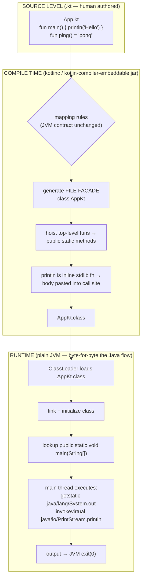
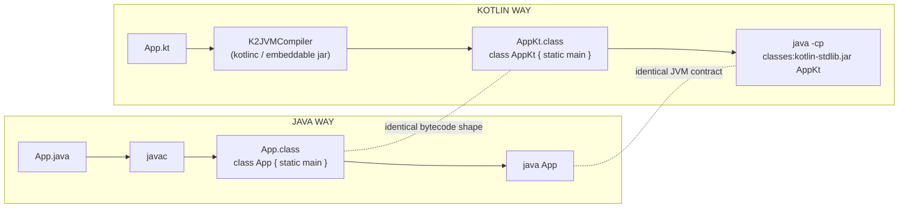

# Kotlin Learning 1 — Kotlin Basics vs Java

## Why Kotlin
- Compiles to JVM bytecode — same runtime as Java (threads, GC, classloaders, memory model identical)
- Null safety, concision, first-class functions, coroutines
- Official Android language (2017), first-class Spring Boot support

## 1. `main` — no class, no ceremony

Java:
```java
public class Main {
    public static void main(String[] args) {
        System.out.println("Hello");
    }
}
```

Kotlin:
```kotlin
fun main() {
    println("Hello")
}
```

- Top-level functions exist — Kotlin doesn't force "everything in a class"
- No `public static void` — `fun`, and `main` works with no `args` parameter at all
- No `new` keyword: `val list = ArrayList<String>()`

## 2. `val` vs `var` — immutability by default

```kotlin
val x = 5      // like `final int x = 5` — cannot reassign
var y = 10     // like `int y = 10` — reassignable
y = 20         // fine
x = 6          // compile error
```

- Style rule: always reach for `val` first; `var` only when mutation is genuinely needed.
- `val` = immutable REFERENCE, not immutable object:

```kotlin
val list = mutableListOf(1, 2)
list.add(3)               // allowed — mutating contents
list = mutableListOf()    // error — reassigning the reference
```

## 3. Type inference — compiler knows

```kotlin
val name = "TiKam"        // inferred: String
val count = 42            // inferred: Int
val price = 99.5          // inferred: Double (like Java)
val f = 99.5f             // Float needs suffix, like Java

val ids: List<Int> = listOf(1, 2, 3)   // explicit type when wanted
```

Idiomatic rule: types on public API signatures, inference inside function bodies.

## 4. Basic types — same JVM primitives, stricter rules

| Java | Kotlin | Gotcha |
|---|---|---|
| `int` | `Int` | No silent widening: `val d: Double = 5` fails — write `5.0` or `5.toDouble()` |
| `double` | `Double` | |
| `boolean` | `Boolean` | |
| `long` | `Long` | |
| `char` | `Char` | No numeric relationship to Int — `'a' + 1` fails |

No bare primitives in the language type system, but the compiler compiles `Int` etc. down to raw JVM primitives (`int`, `long`...) wherever possible — zero boxing cost in normal code.

## 5. String templates

```kotlin
val name = "TiKam"
val age = 24

println("My name is $name, age $age")        // interpolation
println("Next year I'll be ${age + 1}")      // expressions need ${}
println("Length: ${name.length}")
```

Raw strings (no escaping):

```kotlin
val json = """
    {
      "name": "$name",
      "age": $age
    }
""".trimIndent()
```

## 6. Functions — and parameters

```kotlin
fun add(a: Int, b: Int): Int {
    return a + b
}
```

Read left-to-right: `fun` named `add`, takes `a: Int`, `b: Int`, returns `Int` — return type is written AFTER, not before.

Single-expression form (no braces, `return` implied):

```kotlin
fun add(a: Int, b: Int) = a + b
fun greet(name: String) = "Hello, $name"
```

`Unit` is Kotlin's `void` (usually omitted).

Named + default arguments (kill the builder pattern / overloads):

```kotlin
fun connect(host: String, port: Int = 8080, timeout: Long = 5000) { ... }

connect("db.internal")                    // defaults used
connect("db.internal", port = 9090)       // skip middle params
connect(host = "db.internal", timeout = 1000)
```

## 7. `Any` vs `Object`, `if` as expression

- Root of all classes is **`Any`** (declares `toString`, `equals`, `hashCode`). No `Object` type name, no `new`, no `instanceof`:

```kotlin
if (x is String) { x.length }     // 'is' + smart cast
```

- `if` is an **expression** (returns a value):

```kotlin
val max = if (a > b) a else b
```

---

## 8. Kotlin runtime == JVM runtime (same underneath)

Everything below the language layer is 100% shared with Java:

| Layer | Java | Kotlin |
|---|---|---|
| Threading | `java.util.concurrent` | identical (same JVM threads) |
| Memory model | JMM | identical |
| GC | HotSpot / ZGC / ... | identical |
| Classloaders | bootstrap → app | identical |
| Bytecode | `.class` files (by javac) | `.class` files (by kotlinc) |

`kotlin-stdlib` is just a dependency jar. **No Kotlin VM exists.**

## 9. Top-level `fun` → JVM statics: the "file facade" (compile-time trick)

**JVM rule: methods always live inside classes** — at bytecode level there are no free-floating functions. Kotlin satisfies this by generating ONE synthetic carrier class per `.kt` file, named `<FileName>Kt` (the **file facade**), and hoisting every top-level function into it as `public static`:

```
App.kt                                  (source: ONE file)
 ├─ fun main()  { println("Hello") }
 └─ fun ping() = "pong"

        │  compiled ONCE (K2JVMCompiler — kotlinc / the embeddable jar)

AppKt.class                             (what actually gets emitted)
  public final class AppKt
    public static void main(String[])   ← your main
    public static String ping()         ← your ping
```

The JVM never sees the original file shape and has zero Kotlin awareness. `println` is nothing special either — it's an `inline` top-level stdlib function whose body (`System.out.println`) gets pasted into the call site at compile time.

### End-to-end flow, source → compile → runtime



### The two "compilers" side by side



Only real differences: `.kt` source syntax, the compiler tool, and `kotlin-stdlib.jar` on the classpath. Runtime behavior is indistinguishable from Java.

### Where every Kotlin construct lands (Java ↔ Kotlin mapping table)

| Kotlin source | Generated JVM artifact (what Java sees) |
|---|---|
| top-level `fun main()` | `public static void main(String[])` in facade `AppKt` |
| top-level `fun foo()` | `static foo()` in `AppKt` (call from Java: `AppKt.foo()`) |
| `@file:JvmName("Bootstrap")` | facade renamed `Bootstrap` instead of `AppKt` |
| `class Person(val name: String)` | `private final String name` field + ctor + `getName()` |
| `val`/`var` property | private field + getter/setter accessors |
| `data class` | + `equals()`, `hashCode()`, `toString()`, `copy()` |
| `object Singleton` | class + `private static Singleton INSTANCE` |
| `companion object` | inner `Companion` class + static bridge |
| `suspend fun` | extra hidden `Continuation` parameter |
| default arguments | synthetic `$default` bridge method (no overloads needed) |


### Verify it by hand (commands used today)

The compiler is already on this machine via the Maven Kotlin plugin (cached in `~/.m2`). Full manual `javac → java` equivalent flow:

```bash
# 1. COMPILE (the 'javac' step) — the Kotlinc CLI is itself just a JVM app:
java -cp "$HOME/.m2/repository/org/jetbrains/kotlin/kotlin-compiler-embeddable/2.2.0/kotlin-compiler-embeddable-2.2.0.jar" \
  org.jetbrains.kotlin.cli.jvm.K2JVMCompiler App.kt Person.kt -d classes

# 2. INSPECT (proves the facade mapping):
javap classes/AppKt.class     # public final class AppKt + public static void main
javap classes/Person.class    # public final class Person + ctor + getName()

# 3. EXECUTE with the plain JVM (only "dependency" needed: stdlib jar):
java -cp "classes:$HOME/.m2/repository/org/jetbrains/kotlin/kotlin-stdlib/2.2.0/kotlin-stdlib-2.2.0.jar" AppKt
```

Why not `kotlinc` from the terminal? IntelliJ's Kotlin plugin uses its own internal compiler inside the IDE and does NOT put `kotlinc` on PATH — but the Maven cache holds the same compiler, and it is just a jar, so `java -cp ... K2JVMCompiler` is the manual equivalent.

## Exercises (from the lesson)

- **E1.** One-line `scream(name: String)` returning uppercase + `"!!!"` using a string template
- **E2.** Rewrite Java overloads `reserve(user, 1)` / `reserve(user, seats)` with Kotlin default args
- **E3.** Identify compile errors: `a = 7` (val reassign) / `val b: Double = 7` (no widening) / `s = s + " there"` (var, fine) / `val c: Char = 65` (Char isn't numeric)
- **E4.** Raw string + template computing `36` from `n = 3` via `${n * 12}`
